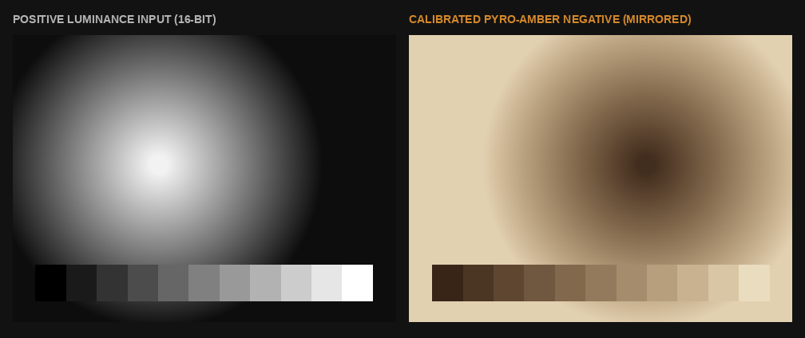
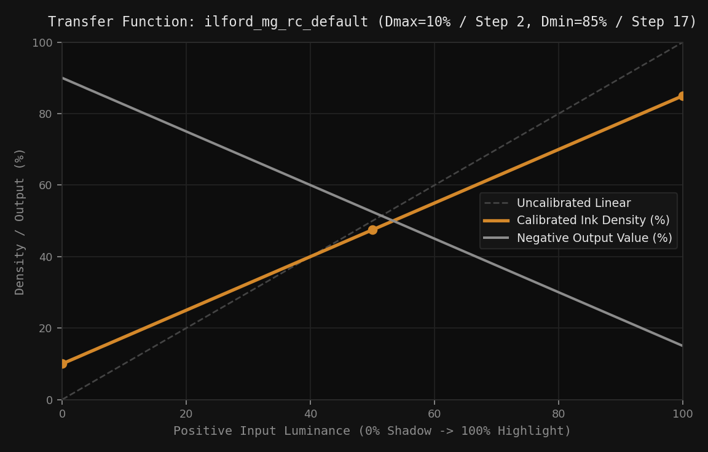
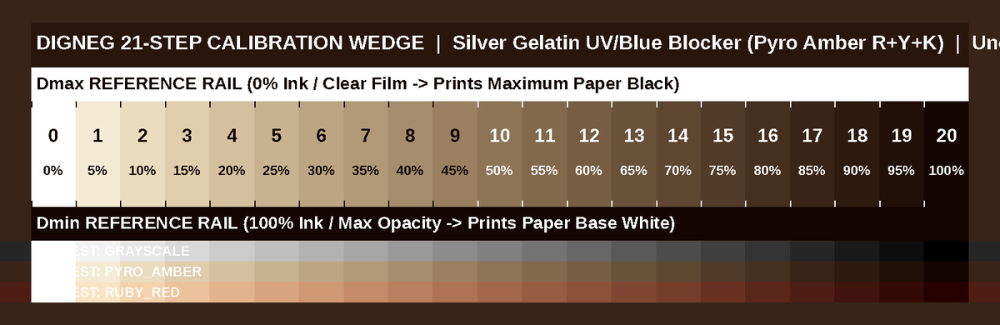

# `digneg` — 16-Bit Digital Negative & Step Wedge Profiler

`digneg` is a 16-bit digital negative calibration and conversion toolkit for **Silver Gelatin** and alternative contact printing on home inkjet printers using OHP transparency film.

It includes both a **stateless web interface** (with client-side `localStorage` profile management so it can be hosted and accessed remotely) and a **command-line interface (CLI)**.

---

## Visual Overview

### Positive Input vs. Calibrated Pyro-Amber Digital Negative


### Monotonic PCHIP Transfer Function & LUT Curve


### 21-Step Calibration Tablet with $D_{\max}$ / $D_{\min}$ Reference Rails & Multi-Ink Strip


---

## Key Features

- **Full 16-Bit Pipeline (`uint16`)**: Reads 8-bit and 16-bit PNG, JPEG, and TIFF images and writes uncompressed 16-bit grayscale or 16-bit RGB baseline TIFFs with preserved DPI metadata.
- **Spectral UV/Blue-Blocking Ink Modes**:
  - `pyro_amber`: Combines Yellow, Magenta/Red, and Black dye channels so home dye-ink printers achieve full UV/blue optical density ($D_{\min}$ paper white) on silver gelatin paper without ink puddling on OHP film.
  - `ruby_red`: Preserves red transmission in midtones like a built-in safelight mask while blocking blue/green light.
  - `grayscale`: Standard 16-bit monochrome output for pigment ink printers.
- **O(1) 65,536-Entry 16-Bit LUT**: Precomputes a 65,536-entry `uint16` lookup table via monotonic PCHIP (`scipy.interpolate.PchipInterpolator`) and gamma shaping for fast full-resolution exports.
- **Stateless Web Interface (`localStorage`)**: Calibration profiles are saved directly in your browser's `localStorage` (with JSON export/import), allowing the server to be hosted anywhere without server-side state.

---

## Linux Development Environment Setup

### 1. Prerequisites (Ubuntu / Debian / Pop!_OS)

Install Python 3.9+ along with the required scientific/imaging libraries via `apt` or `pip`:

```bash
sudo apt update
sudo apt install -y python3 python3-pip python3-venv \
  python3-numpy python3-scipy python3-pil python3-click python3-matplotlib
```

### 2. Clone & Configure Virtual Environment

You can either create a virtual environment inheriting system packages (fastest on Ubuntu/Debian) or install dependencies via `pip`:

```bash
git clone <repository-url> digital_negatives
cd digital_negatives

# Option A: Virtualenv using system scientific packages
/usr/bin/python3 -m venv --system-site-packages .venv
source .venv/bin/activate
pip install --no-build-isolation --no-deps -e .

# Option B: Isolated virtualenv from PyPI
python3 -m venv .venv
source .venv/bin/activate
pip install -e .
```

*(You can also run directly without installing by prefixing commands with `PYTHONPATH=src /usr/bin/python3 -m digneg`.)*

### 3. Run the Test Suite

```bash
PYTHONPATH=src /usr/bin/python3 -m unittest discover -s tests -v
```

---

## Usage

### Web Interface (Recommended)

Launch the web interface on port `8080`:

```bash
digneg web --host 0.0.0.0 --port 8080
# Or without installing the package:
PYTHONPATH=src /usr/bin/python3 -m digneg web --host 0.0.0.0 --port 8080
```

Then open **`http://127.0.0.1:8080`** in your browser:

1. **Negative Converter**: Drop a positive image (PNG, JPEG, 8/16-bit TIFF), select a profile from browser storage, inspect the live side-by-side positive vs. negative preview, and export the print-ready **16-bit TIFF**.
2. **Calibration Curves**: Create, edit, import, or export step-wedge profiles stored in your browser's `localStorage` while inspecting the live PCHIP transfer curve.
3. **Step Wedge**: Render and export custom 16-bit calibration step tablets (`2`–`101` steps) with $D_{\max}$/$D_{\min}$ reference rails and an optional 3-mode ink comparison strip.
4. **Darkroom Procedure**: Built-in reference guide for finding Base Exposure Time ($D_{\max}$), exposing the step wedge, and selecting Multigrade filters.

---

### Command-Line Interface (CLI)

1. **Generate a 21-Step Calibration Wedge (`step_wedge_21.tiff`)**:
   ```bash
   digneg wedge -s 21 --width 8.0 --height 2.5 --dpi 300 --ink-mode pyro_amber -o step_wedge_21.tiff
   ```

2. **Create a Calibration Profile JSON from Dry Print Readings**:
   ```bash
   digneg calibrate \
     --name ilford_mg_rc \
     --steps 21 \
     --black-step 2.0 \
     --white-step 17.0 \
     --midtone-step 9.5 \
     --ink-mode pyro_amber \
     -o profiles/ilford_mg_rc.json
   ```

3. **Convert a Positive Photo to a 16-Bit Calibrated Digital Negative**:
   ```bash
   digneg convert input_photo.tif -p profiles/ilford_mg_rc.json -o output_negative_16bit.tiff
   ```

---

## Darkroom Calibration Summary

1. **Multigrade Filter**: Place a **Grade 2** filter in your enlarger and keep it there for both calibration and final printing. (If Step 20 does not reach pure paper white at Grade 2, step up to **Grade 3 / 3.5** where `pyro_amber` blocks blue light more strongly.)
2. **Lock in Base Exposure Time ($D_{\max}$)**: Find the shortest exposure time where clear OHP film produces maximum paper black ($D_{\max}$) matching bare exposed paper. If making multi-exposure bands on the step wedge, always step your mask **perpendicular to the steps** (crossing all 21 steps), never parallel along them.
3. **Single Flat Exposure**: Contact-print the uncalibrated 21-step wedge **ink-side down** at your locked Base Exposure Time.
4. **Read the Reference Rails**:
   - **Black Point Step ($D_{\max}$)**: Highest step number still indistinguishable from the **0% Ink Top Reference Rail**.
   - **White Point Step ($D_{\min}$)**: Lowest step number that reaches pure paper white matching the **100% Ink Bottom Reference Rail**.
   - **Midtone Step**: Step number that visually matches 50% middle gray.

---

## Project Folder Structure

```text
digital_negatives/
├── pyproject.toml                  # Package metadata, dependencies, and CLI entry point
├── README.md                       # Project documentation and darkroom workflow guide
├── docs/
│   └── images/                     # Visual examples (step wedge, curve plot, comparison)
│       ├── calibration_curve.png
│       ├── positive_vs_negative.png
│       └── step_wedge_sample.png
├── profiles/
│   └── ilford_mg_rc_default.json   # Starter 21-step Silver Gelatin calibration profile
├── src/
│   └── digneg/
│       ├── __init__.py             # Package version
│       ├── __main__.py             # `python3 -m digneg` entry point
│       ├── cli.py                  # Click CLI (`web`, `wedge`, `calibrate`, `convert`)
│       ├── io_utils.py             # 8/16-bit image loader & uncompressed 16-bit TIFF encoder
│       ├── processor.py            # 65,536-entry 16-bit LUT negative conversion pipeline
│       ├── profile.py              # CalibrationProfile model, PCHIP math & spectral LUTs
│       ├── wedge.py                # 16-bit step wedge & reference rail generator
│       ├── web.py                  # Stateless HTTP server & JSON/TIFF API handlers
│       └── static/                 # Frontend web assets (localStorage profiles)
│           ├── index.html
│           ├── styles.css
│           └── app.js
└── tests/
    └── test_digneg.py              # Automated unit & integration test suite
```
